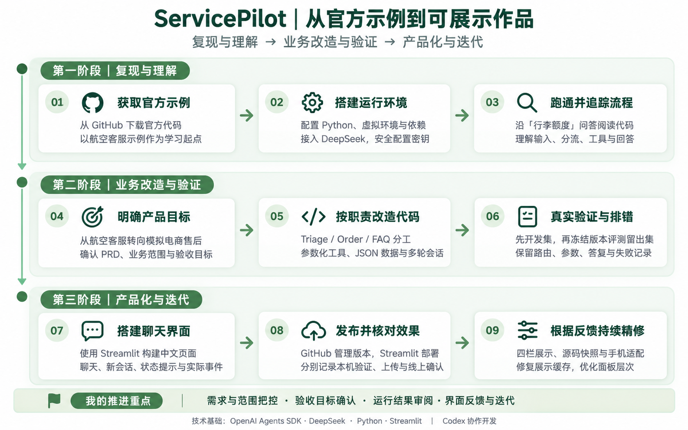

# ServicePilot · 模拟电商售后 Agent 工作台

基于 **OpenAI Agents SDK** 航空客服示例，在 Codex 协作下改造的中文售后 Demo。使用 **DeepSeek + 参数化工具 + 本地模拟数据**，完成订单查询、政策查询、多轮补充及角色交接，并展示实际执行事件。

**[打开在线 Demo](https://servicepilot-c74sbjqk5s8ppt6tbmwltm.streamlit.app/)** · [项目收尾交接](ServicePilot/docs/2026-10-17-项目收尾与GitHub交付.md) · [PRD](ServicePilot/docs/PRD.md) · [任务看板](ServicePilot/docs/任务看板.md)



## 当前交付

四栏工作台：**客服体验 / 架构总览 / 项目介绍 / 代码解读**。桌面采用单行共用顶栏，手机保留两行；项目介绍与代码章节采用白色面板。完整代码面板默认收起，按22文件清单展示同一稳定快照，可选文件、查看行号、复制和内部滚动。

当前应用对应发布 `a5bf69b`、展示版 **r5**，用户已确认公网单行顶栏、四栏切换与r5正常。本次收尾补齐仓库材料，保持该应用运行源及快照不变。仓库新增文档不等于重新完成模型验收。

## 可以体验什么

| 场景 | 示例 | 实际行为 |
| --- | --- | --- |
| 订单查询 | 我的订单 A1001 到哪了？ | 调用 `query_order`；蓝牙耳机、已发货、模拟物流、MOCK1001 |
| 多轮补充 | 帮我查一下订单 → A1002 | 缺编号先追问；台灯、待发货、暂无物流 |
| 政策查询 | 签收后几天内可以申请退货？ | 调用 `lookup_faq`；7天内可提出申请，需人工审核 |
| 话题切换 | 先问退货政策，再查 A1001 | 同一会话内 FAQ → Triage → Order，查询本次记录 |
| 边界处理 | 错误编号、查无订单、未收录政策、故障 | 区分结果状态，说明当前能确认的事实 |

新会话会重建后台上下文；不同页面会话隔离，处理中限制重复发送。仅浏览栏目、源码选择和复制不会请求模型。

订单和政策均为模拟数据；运单不是实际物流。没有签收日期、预计送达时间、运费或退款到账记录；不执行真实退款、工单，不接入真实商家或真人客服。

## 核心流程与结构

`中文输入 → OrderSession → Triage → FAQ / Order → lookup_faq / query_order → 模拟JSON → 根据工具结果回答`

模型选择交接与工具调用，SDK的Runner执行并继续运行，本地工具提供事实；页面呈现本轮实际结果。Agent、模型配置、工具、数据、会话和界面分别组织。

```text
ServicePilot/
  app.py                       Streamlit入口与四栏
  servicepilot/                Agent、工具、数据源、模型、会话、展示模块
  data/                        模拟订单和政策
  evaluations/cases-v1.json     15条开发集、10条留出集
  tests/                       离线工具、流程、会话、证据及页面检查
  scripts/                     启动、评测、快照与交付导出
  docs/                        PRD、看板、报告、交接与演示材料
  assets/                      应用图片、架构源图、设计参考与源码快照
  reviews/                     学习路线图和复盘材料
  artifacts/                   筛选后的复核摘要、离线结果与实际截图
openai-agents-python-main/     航空入口所需的最小参照文件与原许可
```

仓库包含完整项目交付材料；页面的“完整代码展示”仍按原22文件产品清单开放，不展示所有文档、测试或历史资产。`requirements.txt`和`.streamlit/config.toml`在根目录用于部署，同时在产品目录保留相同副本供本地完整性检查。

## 本机安装、启动和停止

已有环境可继续双击 `ServicePilot/启动聊天页面.cmd`。新目录使用 **Python 3.13**，在仓库根目录执行：

```powershell
py -3.13 -m venv '.\openai-agents-python-main\.venv'
& '.\openai-agents-python-main\.venv\Scripts\python.exe' -m pip install -r requirements.txt
& '.\openai-agents-python-main\.venv\Scripts\python.exe' -m pip check
& '.\openai-agents-python-main\.venv\Scripts\python.exe' -X utf8 ServicePilot/scripts/run_web.py
```

仅在启动终端的 `DeepSeek API key:` 后隐藏输入密钥，不把密钥粘到聊天、源码、命令参数或浏览器。打开 **http://127.0.0.1:8501/**；启动窗口保持运行，按 **Ctrl+C** 停止。换端口可追加 `--port 8502`。修改后台后应重启服务。

已验证环境：Python3.13.16、openai-agents0.23.1、openai3.28.0、Streamlit1.65.0。完整Windows依赖记录另见 `ServicePilot/requirements.lock.txt`；未在第二台设备重新安装验证。现有SDK从安装包加载，参照目录不是整份SDK源码或预打包虚拟环境。

## 检查与真实评测

从仓库根目录运行离线检查，不调用模型：

```powershell
$env:PYTHONPATH = (Resolve-Path ServicePilot).Path + ';' + (Resolve-Path ServicePilot/scripts).Path
& '.\openai-agents-python-main\.venv\Scripts\python.exe' -m unittest discover -s ServicePilot/tests -v
& '.\openai-agents-python-main\.venv\Scripts\python.exe' ServicePilot/scripts/build_public_source.py --check
```

真实评测会请求模型并产生用量，仅在需要时运行：

```powershell
& '.\openai-agents-python-main\.venv\Scripts\python.exe' -X utf8 ServicePilot/scripts/run_evaluation.py --split both --review-gate
```

| 记录 | 结果与范围 |
| --- | --- |
| 固定后台评测 `4f49d09` | 最终开发 **15/15**；留出第2轮重测 **10/10** |
| 留出首轮 | 保存异常导致中断，已有4条通过，原失败/未完成记录保留；不是首次盲评全部通过 |
| 历史云端必要回归 `7792895` | **5/5**，与后台25条分开记录 |
| 最近r5界面 | 最终18项离线检查及桌面/手机、会话、复制与滚动检查；用户确认公网显示 |

这些是各自版本的真实记录，不代表任意问题准确率。当前r5云端最小真实问答独立复核、输入法组合态Enter、录屏及长期稳定性仍待完成。本次仓库整理不重跑历史模型评测。

## 材料与证据入口

- [项目收尾与GitHub交付](ServicePilot/docs/2026-10-17-项目收尾与GitHub交付.md)
- [25条评测报告](ServicePilot/docs/2026-10-14-25条评测报告.md) · [复核摘要](ServicePilot/artifacts/evaluation/evaluation-review-2026-10-14.json)
- [方案B实施交接与真实前后截图](ServicePilot/docs/2026-10-17-方案B单行顶栏实施交接.md)
- [三分钟演示与录制步骤](ServicePilot/docs/三分钟演示与录制步骤.md) · [个人贡献说明](ServicePilot/docs/个人贡献说明.md)
- [学习路线图和讲述稿](ServicePilot/reviews/learning-roadmap-v1.md) · [基线与启动说明](ServicePilot/docs/基线与启动说明.md)

设计效果图、历史运行截图和当前验证分别标识。仓库保留评测/故障复核摘要和筛选后的截图；密钥、虚拟环境、缓存、认证文件和原始会话日志不上传。历史文档中指向本机原始记录的索引仍保留，不能将其理解为全部原始日志均已随仓库提供。本机历史提交号和基线标签用于原工作区追溯，本仓库沿用精简发布历史。

## 来源、协作与部署

参考 [OpenAI Agents SDK](https://github.com/openai/openai-agents-python) 航空客服示例，复用Agent、Runner、handoff及工具机制；原示例MIT许可见 `THIRD_PARTY_LICENSE` 和参照目录 `LICENSE`。本人参与需求和范围确认、验收目标确认、本机运行配合、结果审阅及界面反馈；Codex协助实现、排错、验证和材料整理，DeepSeek提供模型服务。

现有Streamlit应用入口为 `ServicePilot/app.py`，依赖取根 `requirements.txt`。服务端密钥使用既有Secrets，不能写入仓库。仓库继续保持私有，在线Demo的访问设置不因此改变。后续仅同步运行包时应按清单更新指定文件并保留文档/测试/资产，不使用会删除完整交付目录的镜像覆盖。

早期 `run_day1.ps1`、`run_official_customer_service.py`、`check_environment.py`及旧上传CMD保留为开发历史，依赖当时的本机目录/诊断记录，不能直接视为新克隆的通用入口。当前页面用上面的 `run_web.py`；航空对照使用 `run_deepseek_customer_service.py` 和仓库所附最小官方参照文件。
